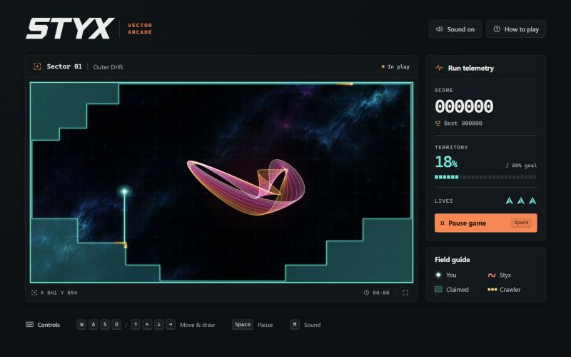

# STYX · Vector Arcade

Open `index.html` in a browser to play offline. All game code, sounds, and artwork run locally. No installation or build step is required.

Press **Enter** to start. Steer the white diamond with **WASD** or the **arrow keys**. Each turn sets your direction until you turn again, reach the edge, or close a trail. On a touchscreen, swipe across the field or use the direction buttons.

Leave the cyan territory and return to safe ground to capture the area separated from the Styx. Avoid crossing your trail, letting the Styx cut it, or meeting an edge crawler. You start with three lives. Claim **80%** to advance to the next sector.

Use **Space** to pause or resume and **M** to toggle sound. The game saves your best score in the browser when local storage is available.

## How it is built

Vector Arcade runs entirely in the browser. The HTML holds the playfield and score panel, CSS handles the desktop and touch layouts, and plain JavaScript runs the simulation and draws each frame. [HTML](index.html) · [Stylesheet](style.css) · [Game source](game.js)

### How a cut claims territory

The board is a **168 × 100 grid**. While you draw, the game records each cell in your trail. When you reach safe ground, the trail becomes a wall. A flood fill starts at the Styx and visits every open cell it can reach by moving up, down, left, or right. Every open cell it fails to reach becomes yours. This is why even the larger side of a cut can be captured if the Styx is on the smaller side.

After each capture, the game traces the new boundary and moves each crawler to the nearest point on its patrol route. It counts claimed cells inside the outer border to update the percentage. Each percentage point gained earns about 100 points times the sector number.

### How the Styx moves and glows

The nebula is a local WebP image. The Styx itself is drawn live on a 2D canvas. Each frame, the game calculates **43 curves of 121 points each** using sine and cosine waves with slightly different phases. Screen blending brightens the places where the curves overlap. Collision detection samples every third curve against the exposed trail, so the twisting tips can cost you a life even when the center passes clear. [Nebula artwork](nebula.webp) · [Rendering and collision code](game.js)

The renderer caches the grid, territory hatching, and borders on a second canvas and repaints that layer after a capture or resize. During play, `requestAnimationFrame` targets 60 frames per second, while the player advances one grid cell per 32 milliseconds of movement.

### Sound and saved settings

The Web Audio API generates each cue with an oscillator. A capture plays two rising tones in succession, while losing a life plays a descending triangle wave. The browser stores the high score and sound preference in `localStorage` under `styx-best` and `styx-audio`.
