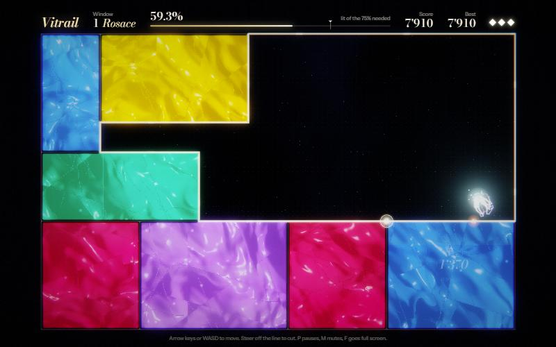

# Vitrail — Claude version

A territory-cutting arcade game built with Claude (Anthropic), in the genre of Styx and
Qix but with its own theme: you are a diamond glass-cutter, and every region you seal
becomes a pane of backlit stained glass. A finished level is a glowing window.

The whole game is one file, `index.html`. Graphics and sound are generated in the
browser (WebGL 2 and Web Audio); there are no image or audio files.

**[Play it in your browser](https://iago-swi.github.io/styx/Claude/)**

## Run it

Play online with the link above, or download the folder and open `index.html` in a
current version of Chrome, Edge or Firefox. No installation,
build step or web server is needed. The two typefaces load from Google Fonts; without
an internet connection the game falls back to system fonts.

## How to play

Steer the diamond along the glowing line. Turn into the dark to start a cut, and reach
any line again to seal the pane: everything on the side without the Wisp lights up.
Light 75% of the window to finish it (78% from window 3, 80% from window 5).

| Key | Action |
| --- | --- |
| Arrow keys or `WASD` | Move |
| `P` or `Esc` | Pause |
| `M` | Sound on/off |
| `F` | Full screen |
| `Enter` | Start |

On a touch screen, swipe to steer and tap to stop.

| Danger | What it does |
| --- | --- |
| The Wisp | Drifts in the dark and dashes now and then. If it or its tendrils touch an unfinished cut, you lose a diamond. |
| Cinders | Run along the lines and hunt you. Touching one costs a diamond. If one reaches the start of your open cut, the cut catches fire and the flame chases you. |
| Boxing yourself in | A cut cannot cross itself. With no way out, you lose a diamond. |

You have three diamonds. Larger panes score more than several small ones. From
window 4 there are two Wisps; separate them with a cut and the window is finished
at once. The best score is kept in the browser.

## Technical notes

### Stack

| | |
| --- | --- |
| Delivery | One `index.html` of about 970 lines (64 KB): markup, CSS, JavaScript and GLSL together. No dependencies, no build step. |
| Language | Plain JavaScript (ES2020) in a single closure, no framework. |
| Rendering | WebGL 2 (GLSL ES 3.00) for the scene and post-processing, Canvas 2D for lines, creatures and sparks, HTML and CSS for the score bar and screens. |
| Sound | Web Audio API. Every sound is synthesised; there are no audio files. |
| Type | Bodoni Moda and Instrument Sans from Google Fonts, with system fallbacks. |
| Storage | One `localStorage` key, `vitrail.best`, for the best score. |
| Requirements | A browser with WebGL 2. `EXT_color_buffer_float` is used for HDR render targets when present; otherwise the game falls back to 8-bit targets. |

### The board

The field is a lattice of 96 × 60 steps stored as a 193 × 121 cell grid (`Uint8Array`).
The cutter only stops on cells with two even coordinates; cells with two odd
coordinates are pure area. Every line is therefore a 4-connected wall of cells, and
every sealed region has an interior, so a flood fill can never leak through a
diagonal.

A cell is in one of four states: dark, line, glass, or open cut.

Sealing a cut works like this:

1. The open cut becomes line.
2. A 4-connected flood fill starts from each Wisp (iterative, with a preallocated
   `Int32Array` stack, so there is no recursion and no allocation).
3. Every dark cell the fill did not reach becomes glass and gets the next pane colour.
4. Every line cell with no dark cell among its eight neighbours stops being a live
   line and becomes lead between panes.
5. With two Wisps, if the fill from the first does not reach the second, they have
   been separated and the window is finished.

Cinders that end up on a dead line are moved to the nearest live one.

### Rendering pipeline

Each frame runs these passes:

1. **Mask texture.** The grid is packed into a 193 × 121 RGBA texture: red is the fill
   amount (0 dark, 0.5 on a live line, 1 glass), green is a flash that decays after a
   pane is revealed, blue marks lead, alpha carries the pane colour index.
2. **Light layer.** Live lines, the open cut, the cutter, Wisps, Cinders, sparks and
   score pop-ups are drawn on an offscreen 2D canvas with additive blending, then
   uploaded as a texture.
3. **Scene shader.** One full-screen fragment shader reads the mask and paints the
   dark, the glass and the lead, then adds the light layer.
4. **Bloom.** A threshold pass (0.62) followed by five downsample and four upsample
   passes in the dual-filter style.
5. **Final grade.** Up to four shockwave distortions, chromatic aberration, ACES tone
   mapping, a vignette and film grain.

The mask is sampled twice. Bilinear filtering turns the blocky fill, flash and lead
channels into smooth edges, and the edge of a pane is the 0.5 contour, which runs
exactly through the centre of its border line. The colour index is read unfiltered
with `texelFetch`, so colours never blend across a lead line.

A new pane is not shown at once: each cell gets a reveal time proportional to its
distance from the point where the cut closed (3.4 ms per cell), which produces the
wave of light.

The glass is 4-octave value noise with quintic interpolation, domain-warped once.
Screen-space derivatives (`dFdx`, `dFdy`) of that height field give a surface normal
for diffuse and specular light. The ripple pattern is almost static; the backlight
moves behind it.

The render resolution follows the device pixel ratio up to 2 and is capped at
2.3 megapixels.

### Movement and enemies

- **Cutter.** 22 lattice steps per second. Movement consumes a distance budget per
  frame, so the speed does not depend on the frame rate. The most recently pressed
  direction wins. A corner assist looks up to three steps ahead: pressing a turn
  slightly early follows the line round its corner rather than starting a cut.
- **Wisp.** A wandering heading with random turn rate and speed, bounced off lines and
  glass by a circle-against-grid test, in sub-steps of at most 0.45 cells. A dash has
  three phases: a 0.6 s warning, 0.5 to 0.85 s at 2.3 times base speed, then 3.5 to
  8 s of rest. While you are cutting, a dash may aim at you. The seven tendrils are
  chains of 15 points that follow their leader at a fixed spacing; any point touching
  an open cut counts as a hit.
- **Cinders.** They walk the graph of live lines. Every 2.5 to 5.5 s a Cinder may run
  a breadth-first search for the shortest way along the lines to you, or to the start
  of your open cut, and turn that way. The flame it lights travels at 1.3 times your
  speed.

### Difficulty and scoring

| | Window 1 | Per window after |
| --- | --- | --- |
| Share to light | 75% | 78% from window 3, 80% from window 5 |
| Wisps | 1 | 2 from window 4 |
| Wisp base speed (cells per second) | 21.6 | +2.6 |
| Cinders | 1 | 2 from window 2, 3 from window 4, 4 from window 6 |
| Cinder speed (steps per second) | 12.8 | +1.3 |

A pane that lights *g* percent of the window scores (80 *g* + 6 *g*²) × (1 + 0.25 ×
(window − 1)), rounded to ten, so one large pane beats several small ones. Finishing a
window adds 1000 × window, plus 500 per percentage point above the target, plus 5000
for separating two Wisps.

The five colour themes (Rosace, Aube, Abysse, Braise, Givre) repeat from window 6.

### Sound

A drone of six detuned oscillators runs through a low-pass filter swept by a slow LFO,
with a feedback delay (0.34 s) as reverb. Bells are a sine fundamental with two
inharmonic partials (2.756 and 5.404 times the fundamental), which gives the struck
glass tone. Notes come from a pentatonic scale on a root that changes with the theme.
An open cut sounds a tone that rises with its length.

### Accessibility and behaviour

- With `prefers-reduced-motion`, screen shake, shockwaves, the chromatic flash and
  the title animation are switched off.
- The game pauses when the tab is hidden.
- Touch input: a swipe sets the direction, a tap stops.

### Testing

`window.__vitrail` exposes the game state and a `step(dt)` function that advances the
simulation by a fixed time step. The game was checked with scripted runs through this
hook (cutting, sealing, level change, fuse, Wisp hit, game over) rather than by timed
play, so frame rate on slower graphics hardware has not been measured.
