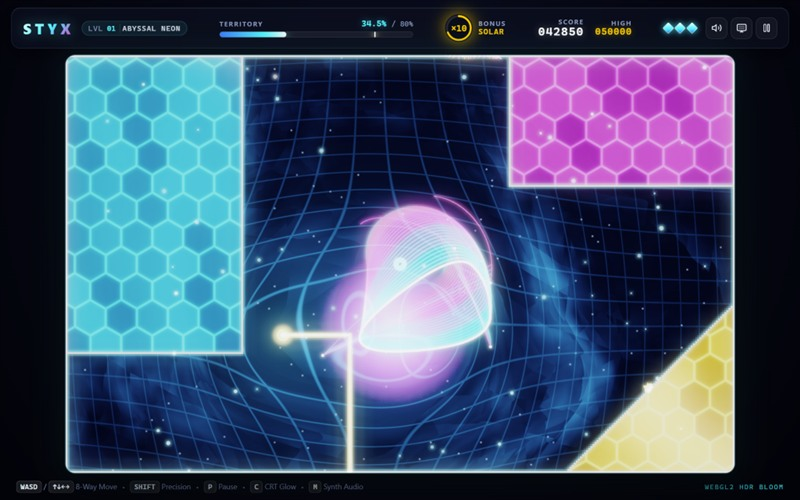

# STYX · Neon Abyss

Open `index.html` in a browser to play offline. All WebGL2 shaders, procedural crystal artwork, neon bloom effects, and Web Audio synthesizer sounds run locally with no installation or build step required.

Press **Space** or **Enter** (or click **Enter the Abyss**) to start. Steer with **WASD** or the **arrow keys** in full 8-way motion (hold two directions for diagonals) and hold **Shift** for precision speed.

Leave the glowing perimeter to carve a plasma tether across the void and reconnect to any safe border to crystallize the enclosed territory. Time your closures with the cycling **×1 / ×5 / ×10** multiplier core to earn huge score bonuses and reveal each realm's stained-glass crystal pattern. Avoid letting the swirling Styx touch your active tether, don't stall in the open (or the Plasma Fuse will ignite!), and watch out for edge-crawling caterpillars—seal a caterpillar inside claimed territory to crush it for a bonus. Claim **80%** to clear each realm (+1,000 bonus per extra percentage point above 80%).

Use **P** or **Esc** to pause, **M** to mute audio, and **C** to toggle optional 1983 CRT scanlines. High scores are saved automatically in browser local storage.
