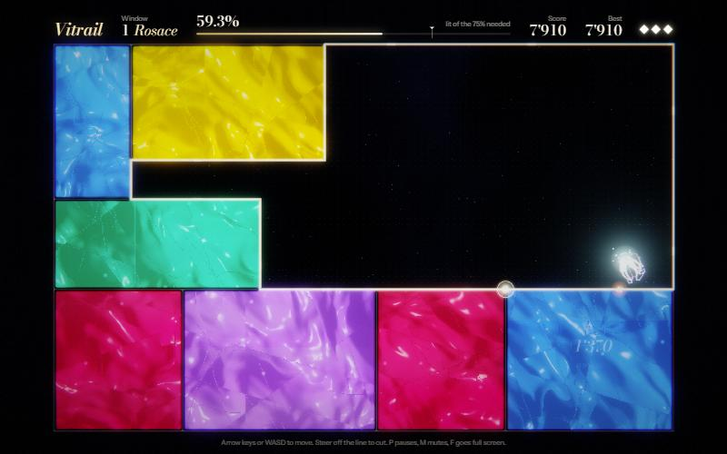

# Styx

A modern territory-capture arcade game inspired by Styx and Qix, built in two versions to compare what different AI assistants produce from the same brief. Steer across open space, reconnect with the border, and claim most of the field before the roaming enemy touches your unfinished line.

| Version | Source and controls |
| --- | --- |
| Claude · Vitrail | [Claude/](Claude/) |
| ChatGPT · Vector Arcade | [ChatGPT/](ChatGPT/) |

Download or clone this repository and open `index.html` in your browser. It is a landing page that links to both versions. Each version is self-contained in its own folder, with its own README.

## Claude version



## Structure

```text
styx/
|-- Claude/    # version built with Claude
|-- ChatGPT/   # version built with ChatGPT
|-- index.html # shared landing page
`-- README.md
```

Read the [original Styx instructions](https://www.digger.org/styx/howplay.htm).
